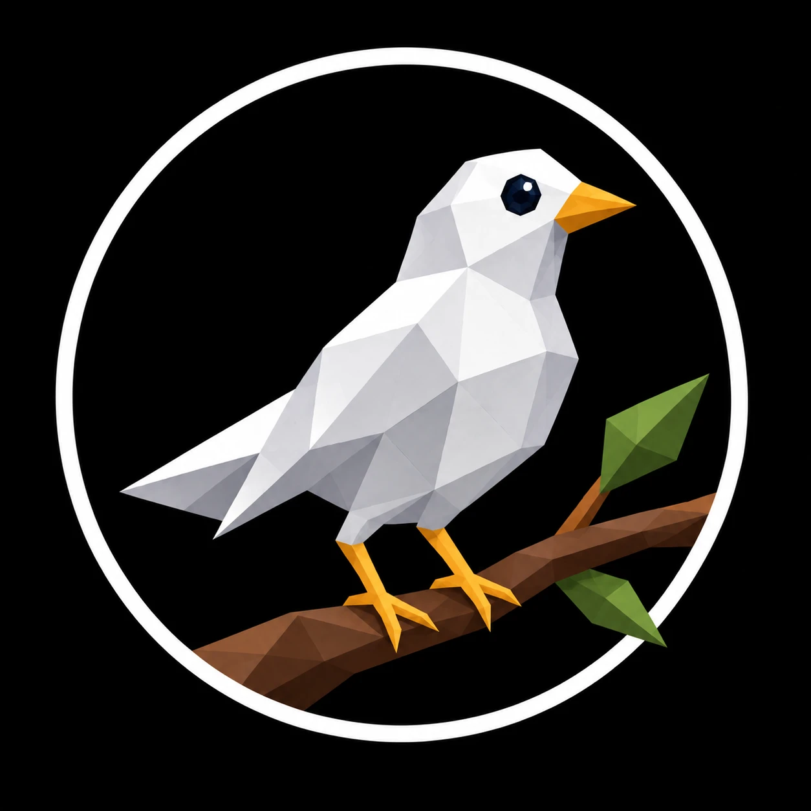

<p align="center"></p>

# MIRLO 64

MIRLO 64 is a Nintendo 64 core made specifically to fit in the Analogue Pocket.

It currently supports over 99% of the game library, and it aims to provide cycle accuracy with original hardware.

## Features

* Controller Pak support.
* Expansion Pak support.
* Up to 2 Transfer Paks support. Games can either be connected to the GB cart on the Pocket or loaded from the SD.
* Save states (Sleep/Wake, Memories) are supported.
* Game Shark support.
* Up to 4 players with the Dock.
* Up to 4 players with original Nintendo 64 controllers with the Analogizer.
* All save types are supported.
* All regions (PAL, NTSC) are supported.
* Full game size (64 MiB) support.

## How to install

1. Download `tortuga.Mirlo64_<version>.zip` from the [releases](https://github.com/tortugaveloz/MIRLO64/releases).
2. Unzip it onto the **root** of the Pocket's SD card, merging with the folders already there. It adds these files:

   ```
   Assets/n64/common/            n64rt.sys (the runtime) and n64savedb.txt; where the games go
   Cores/tortuga.Mirlo64/        the core: mirlo.rev (the bitstream), core.json, ...
   Platforms/n64.json            the platform: Console > Nintendo 64
   Platforms/_images/n64.bin     its image
   ```

   The platform is `n64`: its file and its image are the same ones another core of that platform would bring.

3. Put the games in `Assets/n64/common/`. ROMs need to be provided in `.z64` format (a `.v64` or `.n64` file is the same game in another byte order, and has to be converted to `.z64` first). No game is included.
4. On the Pocket: **openFPGA → Console → Nintendo 64**, then pick a game.

Saves (`.sav`) appear in `Saves/n64/common/` when you quit a game. To update the core, unzip a newer release the same way; it replaces the files in `Cores/tortuga.Mirlo64/`.

**Coming from version 0.1**, whose platform was `mirlo`: move your games from `Assets/mirlo/common/` to `Assets/n64/common/` and your saves from `Saves/mirlo/` to `Saves/n64/`; `Assets/mirlo/`, `Platforms/mirlo.json` and `Platforms/_images/mirlo.bin` can then be deleted.

## Controls

The Analogue Pocket has 8 buttons and a D-Pad. A typical configuration of the Nintendo 64 controller has 9 buttons and a Joystick / D-Pad. By default, L is mapped to ZL and C-Up is mapped to ZR. If you need to use C-Up, I suggest to alter the default configuration as follows:

* Set C-Up to "+".
* In the core options, set Start macro to "C-Down + C-Up".

With this, you will have all buttons accessible. Start can be pressed with the combination C-Down + C-Up, which in that configuration is the "-" and "+" buttons.

For more information about controllers and more controller options, please see [docs/controllers.md](docs/controllers.md).

## More information

* [Settings, saves and cheats](docs/usage.md)
* [Contributing and building from source](CONTRIBUTING.md)

## License

MIRLO 64 is released under the [Apache License 2.0](LICENSE). The third-party material it includes keeps its own license: see [NOTICE](NOTICE).

Nintendo 64 is a trademark of Nintendo. This project is not affiliated with or endorsed by Nintendo or Analogue.

This development is AI assisted.
